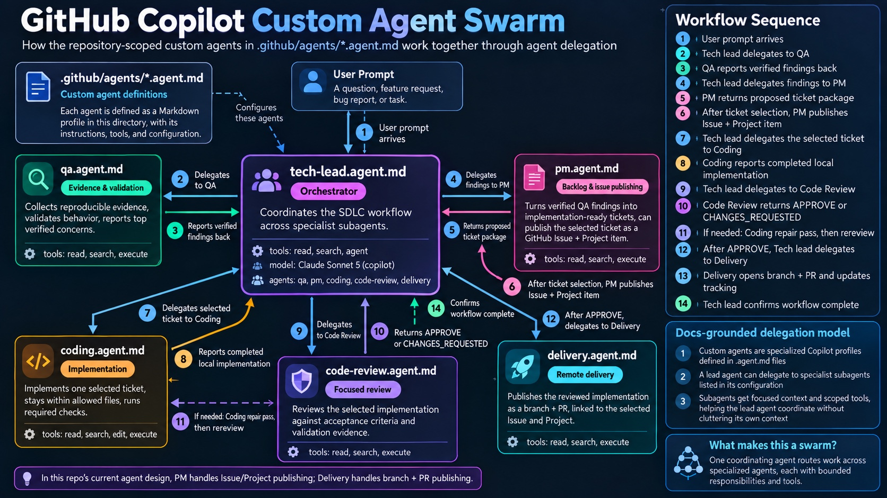

# Session 2: Building with Advanced GitHub Copilot Capabilities

> Go deeper with custom agents, skills, plugins, hooks, and hands-on agentic workflows.

2 hours, virtual, hands-on. The GitHub Copilot App is the main surface; the CLI is
used where it's strongest.

**Through-line:** In Session 1 you used Copilot as it comes. In this session you teach
it how your team works: package conventions as a **skill**, give work to specialized
**custom agents**, enforce policy with **hooks**, bundle all three as a **plugin**, and
hand recurring work to **agentic workflows**.

Today we'll cover skills, custom agents, hooks, and plugins. Agentic workflows are
covered in Session 1's S7.

## Agenda

| Section | Topic | Surface |
|---|---|---|
| Setup | Your own repository (reuse your Session 1 repository if you have it) | Terminal, App |
| S1 | The customization map | App (Customize) |
| S2 | Skills | App |
| S3 | Custom agents | App |
| S4 | Hooks | App, terminal |
| S5 | Plugins | CLI, App |
| S6 | Wrap-up | |

---

## Set up your own repository

If you attended Session 1, open the same repository in the App and skip to S1.
Otherwise, follow *Set up your own repository* in Session 1:
<https://github.com/rko26-tt-shiny-dollop/rogers-workshop-starter/blob/main/SESSION-1.md>

---

## S1. The customization map

### Scenario

Your team keeps typing the same guidance into prompts. Copilot has several places to
put that guidance once. Before building any, see where each one lives and when it loads.

### Background

| Customization | Lives in | Loads | Good for |
|---|---|---|---|
| Custom instructions | `.github/copilot-instructions.md`, `.github/instructions/` | Always, or by file path | Standards that apply everywhere |
| Prompt files | `.github/prompts/<name>.prompt.md` | When you run `/name` (VS Code and other IDEs only) | A reusable task you start by hand |
| Skills | `.github/skills/<name>/SKILL.md` | When the task matches its description | Multi-step workflows with references or scripts |
| Custom agents | `.github/agents/<name>.agent.md` | When you select it | A role with its own tools and rules |
| Hooks | `.github/hooks/hooks.json` | On agent events (start, prompt, stop) | Audit, checkpoints, policy |
| Plugins | Installed bundle with `plugin.json` | After install | Sharing agents, skills, and hooks together |
| MCP servers | `.mcp.json` or App settings | When a tool is needed | Reaching external systems |

Most of these are files in the project itself. Open your repository's `.github/`
folder, then `skills/`, `agents/`, and `hooks/`, and look at what's there.

**Customize → Skills** in the Copilot App lists two kinds of skills. Built-in skills come
with the App and are available in every session. Repository skills come from each project
you've added, and each one only loads in sessions for its own project, even though they all
appear in the list together.

Prompt files don't run in the Copilot App. In the App, a skill does the same job.

### 🧑‍💻 Hands-on

Pick a specific model, such as **Claude Sonnet 5**, rather than Fusion. Fusion can
route each turn to a different model, so how closely the instructions are followed
varies from run to run.

**1. Repository-wide instructions.** Start a new session and send:

```text
Add this helper to the API:

export function summarizeActivation(payload: any): any {
  return {
    count: payload.lines.length,
    total: payload.lines.reduce((sum: any, line: any) => sum + line.price, 0),
  };
}
```

Then, in the same session:

```text
confirm you've followed copilot-instructions.md to shape implementation and explain how
```

**2. Scoped instructions.** Start a new session and send:

```text
Add a stock_quantity column to the products table by editing api/database/migrations/001_init.sql directly.
```

Observe the output. Were the custom scoped instructions followed?

### What to notice

- In the first session, check the code rather than Copilot's summary: the `any` types are
  replaced with typed interfaces. That's `.github/copilot-instructions.md` ("no `any`
  unless justified"), even though your prompt asked for `any`.
- Copilot may not credit the instructions unless you ask. The follow-up gets it to name
  the rules it applied, which you can check against the file.
- `copilot-instructions.md` is always on. Scoped instructions load only when the prompt
  involves files matching the `applyTo:` glob pattern in their frontmatter.

> **Note:** On GitHub.com (Copilot code review and the cloud agent), a scoped instructions
> file is used only when a changed file matches its `applyTo:` pattern. Patterns start at
> the repository root, so use `**/` to match a folder at any depth, for example
> `**/database/migrations/**`. Open `.github/instructions/database.instructions.md` and
> compare its `applyTo:` with where the migrations actually live. Would it apply in a
> Copilot code review?

---

## S2. Skills

### Scenario

Adding an API entity touches a model, repository, routes, migration, seed data, Swagger
docs, and tests. Copilot doesn't do all of it to your standards every time.

### 🧑‍💻 Hands-on

> 1. Open `.github/skills/api-endpoint/SKILL.md` and its `references/` folder.
> 2. Start a new session in a worktree, **Interactive** mode, model **Auto**:
>
>    ```text
>    Add a new API endpoint for a new Entity called 'DeliveryVehicle'. Vehicles belong to branches.
>    ```
>
> 3. When it finishes, send:
>
>    ```text
>    run make test-api, then stop anything on ports 3000 and 5137 and run make dev from this worktree
>    ```
>
>    Then open <http://localhost:3000/api-docs> and find the DeliveryVehicle endpoints.

### What to notice

- Only the skill's name and description were in context until the task matched; then
  Copilot loaded the full instructions and references.
- The skill shows up as its own step in the session, before Copilot reads any code.
- One prompt produced the model, repository, routes with Swagger docs (registered in
  `index.ts`), a new sequential migration, seed data, and repository and route tests,
  then a clean build and passing tests.
- The new table went into a new migration file rather than an edit to `001_init.sql`.
- Copilot may commit to the worktree branch without being asked. Check the session's
  changes before you continue.

---

## S3. Custom agents

### Scenario

Some work needs a specialist: a role with its own rules, tools, and boundaries.

### 🧑‍💻 Hands-on

> 1. Open `.github/agents/bdd-specialist.agent.md`. Notice its description, tools, and
>    rules.
> 2. Start a new session, select the **BDD Specialist** agent, and prompt:
>
>    ```text
>    Add BDD tests for the product list page. Run the focused test suite and report the results.
>    ```

### 🎬 Demo only: a team of agents across the SDLC

Demonstration of an agentic delegation workflow between multiple agents.

[](docs/images/sdlc-agent-swarm.jpg)

Setup:

1. Start a **New session** in a worktree with `demo/sdlc-custom-agents` as the base branch.
2. Before selecting an agent, send:

   ```text
   ensure this session is based off branch it was created from
   ```

3. Then send:

   ```text
   ensure the frontend and backend servers are running from this session's worktree. If other servers conflict on the same ports, stop those processes and start the servers here
   ```

4. Open **+ → Agent** and select **tech-lead**.

### What to notice

- To check the agent ran as expected, compare its output with the rules in
  `bdd-specialist.agent.md`. For example, look for:
  - Gherkin scenarios that cover the normal flow, edge cases, and accessibility
  - Playwright tests run on Chromium and Edge only
  - existing tests left unchanged and still passing
- The agent may stop whatever is running on ports 3000 and 5137 when it finishes,
  including your `make dev` servers from Setup. Restart them if needed.
- Each agent has a narrow job and limited tools. The human still chooses the ticket and
  approves the result.

---

## S4. Hooks

### Scenario

Your team wants an auditable record of what Copilot changed.

### 🧑‍💻 Hands-on

> 1. Start a **New session** and prompt:
>
>    ```text
>    open .github/hooks/hooks.json and .github/hooks/checkpoint-commit.sh in the editor
>    ```
>
>    Find the `sessionStart`, `UserPromptSubmit`, and `Stop` hooks. Open `.agent.log`;
>    your first prompt is already there. Run `git log -1` in the session's
>    **Terminal** tab; the `Stop` hook ran the checkpoint script, but nothing was
>    committed.
> 2. In `checkpoint-commit.sh`, delete the `exit 0` line under
>    "Delete the next line to turn on checkpoint commits". Then add Copilot
>    attribution to the commit message and save. For example:
>
>    ```bash
>    git commit -m "[Checkpoint-commit] $TIMESTAMP
>
>    Co-authored-by: GitHub Copilot <copilot@github.com>" --no-verify 2>/dev/null || {
>    ```
>
> 3. In the same session, prompt:
>
>    ```text
>    Add two rocket emojis 🚀🚀 to the title in the README.
>    ```
>
> 4. When the response finishes, run `git log -1 --stat` in **Terminal**, then
>    reopen `.agent.log`.
>
> Use a new session for the next section so checkpoint commits stay off.

### What to notice

- The hook ran without anyone asking; it's a command, not a prompt.

---

## S5. Plugins

Source: [Creating a plugin for GitHub Copilot CLI](https://docs.github.com/copilot/how-tos/copilot-cli/customize-copilot/plugins-creating).

### Scenario

Your API agent, skill, and audit hooks work in this repository. Other teams building
OctoCAT-style APIs want the same setup, without copying files into every repository.

### 🧑‍💻 Hands-on

> 1. See what another project has before you install. In a terminal, start the CLI in
>    an empty folder:
>
>    ```bash
>    mkdir ~/plugin-demo && cd ~/plugin-demo && copilot
>    ```
>
>    Type `/agent`. There's no API Specialist. Type `/exit`.
>
> 2. In the App, start a **New session** in your workshop repository and prompt:
>
>    ```text
>    Create a Copilot CLI plugin in plugins/octocat-api-toolkit/ (legacy plugin format, no $schema) that packages these existing customizations from this repository. Copy the files; don't move or change the originals.
>    - Agent: copy .github/agents/api-specialist.agent.md to plugins/octocat-api-toolkit/agents/
>    - Skill: copy .github/skills/api-endpoint/ (including references/) to plugins/octocat-api-toolkit/skills/api-endpoint/
>    - Hooks: create plugins/octocat-api-toolkit/hooks.json containing only the sessionStart, UserPromptSubmit, and Stop hooks from .github/hooks/hooks.json that write to .agent.log. Leave out the checkpoint-commit hook.
>    Add plugins/octocat-api-toolkit/plugin.json with name "octocat-api-toolkit", a one-line description, version "1.0.0", and agents, skills, and hooks fields pointing at those locations.
>    ```
>
> 3. In that session's **Terminal** tab, install and check the plugin:
>
>    ```bash
>    copilot plugin install ./plugins/octocat-api-toolkit
>    copilot plugin list
>    ```
>
> 4. Back in your terminal, start the CLI in `plugin-demo` again:
>
>    ```bash
>    cd ~/plugin-demo && copilot
>    ```
>
>    Type `/plugin` and `/agent`. The plugin and its agent,
>    `octocat-api-toolkit:api-specialist`, are listed now. Ask a question, then type
>    `/exit` and check that the plugin's hooks ran in this folder too:
>
>    ```bash
>    cat ~/plugin-demo/.agent.log
>    ```

### What to notice

- A plugin is how customizations travel between repositories and people: install
  once, and the agent, skill, and hooks work in a folder that has none of those files.
- Plugins load when a session starts, so start a new session after installing.
- In the App, a plugin installed from the CLI loads, but its agent doesn't appear in
  the agent picker. To get it in the picker, install the plugin from **Customize**.

---

## S6. Wrap-up

### Putting it together

| You did | With |
|---|---|
| Encoded a workflow | A skill |
| Delegated to a specialist | A custom agent |
| Enforced an audit trail | A hook |
| Shared all three | A plugin |
| Automated failure analysis | An agentic workflow |

### Resources

- [Immersive Experience](https://copilot-academy.github.io/workshops/immersive-experience)
- [Copilot Academy labs](https://copilot-academy.github.io/labs)
- [GitHub Copilot docs](https://docs.github.com/en/copilot)
